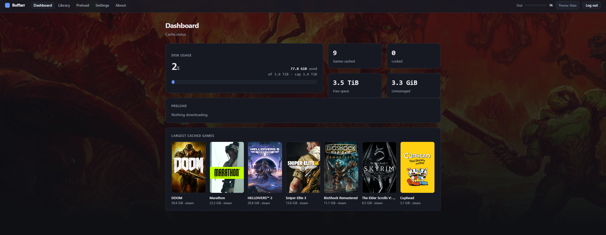

<p align="center">
  
</p>

<h1 align="center">Buffarr</h1>

<p align="center">
  A cache manager for your game downloads.
</p>

<p align="center">
  
  
  
  
  
</p>

<div align="center">

[Install](docs/INSTALL.md) ·
[Sizing](docs/SIZING.md) ·
[FAQ](docs/FAQ.md) ·
[Roadmap](docs/ROADMAP.md) ·
[Contributing](CONTRIBUTING.md)

</div>

Buffarr is a cache manager for your Steam games. It provides a view of what
games are cached, per-game disk usage, one-click protection and deletion, and
on-demand preloading so downloads come from the local network instead of the
internet. It includes library art, per-game preloading and eviction, all in a
performant web UI. Other platforms can be cached, but tracking is limited.



<details open>
<summary><h2>Features</h2></summary>

- **Library.** Your cached games appear as a poster grid with cover art pulled
  from Steam. Click any game to see its
  description, genres, developer, release date, Metacritic score, and cached
  size.
- **Lock.** Pin a game so it is protected from automatic eviction and accidental
  deletion. Locked games survive cleanup. Unlocked ones are fair game.
- **Delete.** Reclaim disk from a single game on demand. Its cached files are
  purged without touching anything else.
- **Preload.** Download games you own before anyone requests them. This is handy
  ahead of a LAN party or release day. A live progress gauge tracks each load.
  A preloaded game is indistinguishable from one cached organically.
- **Max cache size with "Lock wins" eviction.** Set a size limit and Buffarr
  keeps the cache under it by removing the least-recently-used unlocked games
  first. Locked games are never auto-removed, even if that means going over
  the cap.
- **Themeable web UI.** A dashboard with light/dark theme options (Slate, Paper,
  Amber), served as a single Go binary with no separate frontend build.
- **Steam login.** The console is gated behind Steam OpenID. Only the configured
  operator account can sign in.
- **JSON API.** An optional key-authenticated API at `/api/v1/` for scripts and
  integrations: stats for dashboards, lock/delete, and preload triggers. See
  [docs/API.md](docs/API.md).

</details>

<details>
<summary><h2>Platform support</h2></summary>

**Steam is the primary focus.** Depot identification, cover art, owned-games
preloading, and per-game sizing are all Steam-aware. Steam is enabled by
default. Other platforms (Epic, Battle.net, and so on) are supported but
disabled by default. Enable them in Settings. They are cached and tracked as
they are used, but first-class management for them is not currently planned.

</details>

<details>
<summary><h2>How it works</h2></summary>

To use the cache, point your system's DNS at the Buffarr server. When you
install a game from Steam, the request is routed through an nginx cache. If the
file is available locally, it is served from the cache. Otherwise it is
downloaded from Steam's servers. This is transparent to the user.

Buffarr does not read the cached files directly. They are stored under opaque
internal names. Instead, it watches the nginx access log and figures out which
game each download belongs to. It keeps a running size total for each game in a
small database, with a background pass to keep the numbers accurate.

> **A note on sizes.** The size Buffarr reports is the **compressed download**
> size, meaning the bytes that travel over the network and land in the cache.
> Steam's store and library show the **installed** size, which is larger because
> the game is decompressed on disk after downloading. A title Steam lists as
> 50 GB installed might show as roughly 30 GB cached here.

```
LAN client
   │
   ├── DNS ────────►  dnsmasq        (answers CDN hostnames with this server)
   │
   ├── HTTP :80 ───►  nginx (cache)  ──► upstream CDN on a miss
   │                     │
   │                     └── access log ──► backend (tails it, builds the catalog)
   │
   └── HTTPS :443 ─►  nginx (stream)  (SNI passthrough, needed for Steam manifests)

                 backend (Go)
                   ├── SQLite catalog (per-game accounting)
                   ├── web UI + Steam OpenID login
                   ├── PURGE requests back to nginx (the primary eviction authority)
                   └── drives ──►  prefill sidecar (downloads depots through nginx)
```

When the cache reaches its size limit, Buffarr removes the least-recently-used
unlocked games to make room. Locked games are never touched. nginx has its own
built-in size limit as a safety net, but it does not know about Locks. Set the
Buffarr cap below the nginx limit so the safety net never fires. That keeps the
Lock guarantee working.

nginx also removes files that go unaccessed for too long. The cutoff is one year
by default, configurable via `CACHE_INACTIVE` in the compose file. This timer
resets each time a file is requested, so active content is never at risk. The
default is long enough that it effectively never fires. Raise it (for example
`CACHE_INACTIVE=3650d`, about 10 years) to disable this behavior entirely. Lower
it only deliberately. A short value will silently remove files on a timer,
including locked ones, without Buffarr's knowledge.

nginx also keeps an in-memory index of cached files, controlled by
`CACHE_KEYS_ZONE` (default `100m`). Each `100m` covers roughly 800 GB of
content. If the index fills up before the disk does, nginx starts forcing
re-downloads from the internet. For a large cache, size this to match your
disk (≈`470m` per 3.7 TB).

For choosing these values and the hardware to run Buffarr on (NIC, disk, RAM),
see the **[Sizing Guide](docs/SIZING.md)**.

</details>

<details>
<summary><h2>The stack</h2></summary>

Buffarr runs as four Docker containers. The Go backend is a single static binary
(~28 MB image, ~14 MB resident). The other containers exist because HTTP
caching, DNS interception, and Steam prefill each need their own process.

| Container | Role | Exposes |
|---|---|---|
| `buffarr-nginx` | HTTP caching proxy and HTTPS SNI passthrough. Stores game data and serves the PURGE API. | `:80`, `:443` |
| `buffarr-dnsmasq` | DNS interceptor. Redirects game download hostnames to this server. | `:53` tcp+udp |
| `buffarr-backend` | Provides the web UI, catalog, lifecycle management, and orchestration. | `:9443` (`:9080` host-only) |
| `buffarr-prefill` | Steam prefill sidecar (SteamPrefill). Downloads depots on demand. | (none) |

> **The `:443` passthrough is not optional for Steam.** Steam fetches depot
> manifests over HTTPS. nginx handles this without decrypting the traffic. If a
> preload reports success but the Library stays empty, run `docker compose ps`
> and confirm nginx is `(healthy)`.

</details>

<details open>
<summary><h2>Installing</h2></summary>

Full instructions covering prerequisites, `.env` configuration, deployment
modes, first-run Steam setup, DNS, and troubleshooting are in
**[INSTALL.md](docs/INSTALL.md)**.

The short version:

```bash
git clone https://<your-git-host>/buffarr.git
cd buffarr
cp .env.example .env
$EDITOR .env
docker compose up -d --build
```

Open `https://<host-ip>:9443`, complete the first-run Steam setup, authenticate
the prefill sidecar once, and point your clients' DNS at this server. See
**[INSTALL.md](docs/INSTALL.md)** for verification steps.

</details>

<details>
<summary><h2>Notes</h2></summary>

- **The console forgets you on every redeploy.** Sessions are in-memory, so a
  backend restart logs you out. Expect one logout per deploy.
- **Self-signed TLS on first boot.** Supply your own cert and key at the
  configured paths to use a trusted certificate. The console is only served over
  HTTPS (`:9443`). Plain HTTP (`:9080`) is bound to the host loopback and never
  exposed to the LAN.
- **Lock before delete.** You cannot delete a locked game. Unlock it first. The
  two-step prevents accidentally losing protected content.

</details>

<details>
<summary><h2>Documentation</h2></summary>

- **[docs/INSTALL.md](docs/INSTALL.md)**: install runbook (setup, deployment modes, verification, troubleshooting).
- **[docs/SIZING.md](docs/SIZING.md)**: hardware, and how to size the disk cap and key index.
- **[docs/API.md](docs/API.md)**: the JSON API for scripts and integrations.
- **[docs/FAQ.md](docs/FAQ.md)**: common questions (also in the app under **About**).
- **[docs/ROADMAP.md](docs/ROADMAP.md)**: planned features and their status.
- **[CONTRIBUTING.md](CONTRIBUTING.md)**: the QA/QC checklist for changes.
- **[SECURITY.md](SECURITY.md)**: security policy and how to report an issue.

</details>

<details>
<summary><h2>License</h2></summary>

Buffarr is released under the MIT License. See [LICENSE](LICENSE).

</details>

<details>
<summary><h2>Disclaimer</h2></summary>

Buffarr is an independent, unofficial project provided for **educational and
personal use only**. It is **not affiliated with, endorsed by, or sponsored by
Valve Corporation, Steam, or any other game publisher, distributor, or
platform**. All product names, logos, and trademarks are the property of their
respective owners. Buffarr only caches content that clients on your own network
request and that you are entitled to access. You are responsible for using it in
accordance with the terms of service of any service it interacts with.

Buffarr was written with [Claude Code](https://claude.com/claude-code),
Anthropic's agentic coding tool, in collaboration with its author.

</details>
